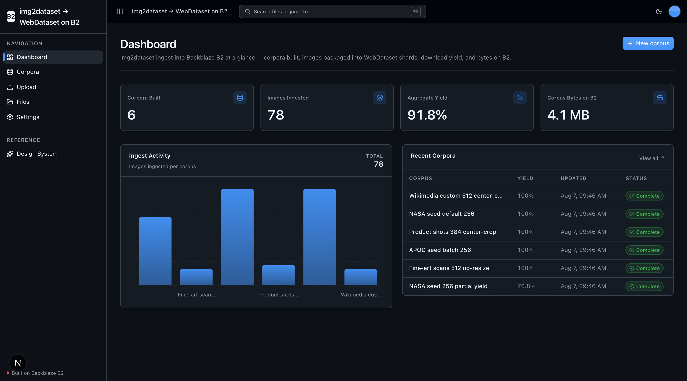
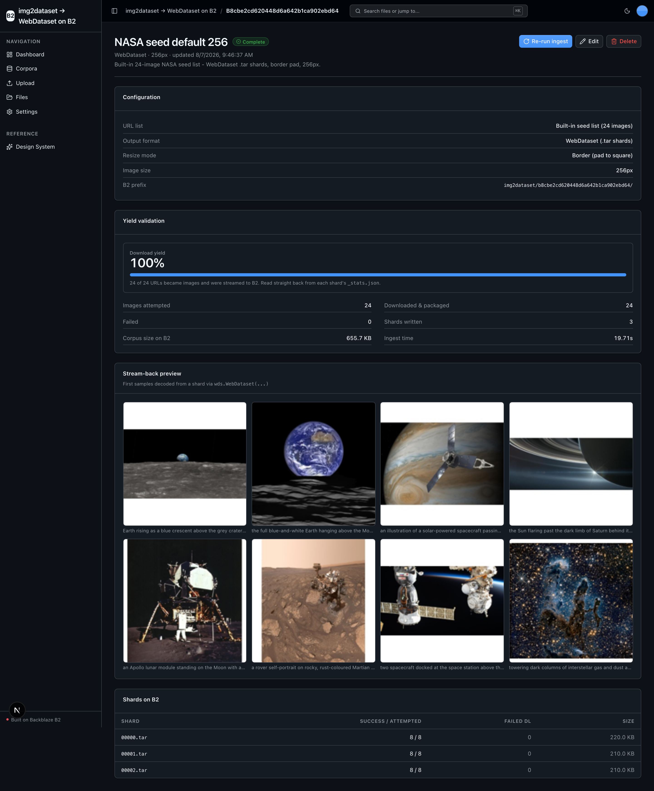

<!-- last_verified: 2026-08-04 -->
# img2dataset → WebDataset on B2

Bulk-download image-text datasets straight into **[Backblaze B2](https://www.backblaze.com/sign-up/ai-cloud-storage?utm_source=github&utm_medium=referral&utm_campaign=ai_artifacts&utm_content=b2ai-img2dataset-webdataset-object-storage)** as reproducible, ready-to-train **WebDataset** tar shards — using the trending OSS tool [`img2dataset`](https://github.com/rom1504/img2dataset), with B2 as the S3-compatible output target and no local staging disk. Point a corpus at a URL-caption list (or the built-in sample list); `img2dataset` fetches, resizes, and packages the images into `.tar` shards + metadata parquet + per-shard `_stats.json`, streaming them directly to B2. The app then validates yield from those stats and proves training-time consumption by streaming a shard back through WebDataset's `IterableDataset` and decoding a few `(image, caption)` pairs.

Explore the [project page](https://backblazelabs.com/projects/img2dataset-webdataset-object-storage/), the official [Backblaze B2 AI integrations and sample applications](https://www.backblaze.com/cloud-storage/b2-ai-integrations?utm_source=github&utm_medium=referral&utm_campaign=ai_artifacts&utm_content=b2ai-img2dataset-webdataset-object-storage) directory, and the checked-in [local OpenAPI contract](docs/api/openapi.json).

**What you get out of the box:**
- A **Corpus** primary entity (an img2dataset ingest job) with full create / read / edit / delete / re-run lifecycle
- Streaming ingest that writes WebDataset `.tar` shards straight to B2 via `img2dataset` — no local staging
- Yield validation read back from each shard's `_stats.json`, and a stream-back preview decoded with the real `webdataset` package
- A scoped **Corpora** explorer plus the full-bucket File Explorer and direct-to-B2 Upload
- FastAPI backend with strict layered architecture and structural tests, and agent-optimized docs

This runs on device: CPU + network only. No GPU, no model, no second API key — Backblaze B2 credentials are all you need.

## What it looks like

Screenshots are added by a later step. The Dashboard shows corpus-ingest metrics
(corpora built, images ingested, aggregate yield, bytes on B2); the Corpus detail
page shows yield validation, the decoded stream-back preview grid, and the shard
list.





## Quick Start

You need: Node.js >= 20, pnpm >= 9, Python >= 3.11, and a free **[Backblaze B2 account](https://www.backblaze.com/sign-up/ai-cloud-storage?utm_source=github&utm_medium=referral&utm_campaign=ai_artifacts&utm_content=b2ai-img2dataset-webdataset-object-storage)**.

### Supported local environments

Local scripts are supported on macOS, Linux, and WSL2. Native Windows is not
supported yet because the dev scripts use POSIX shell syntax and
`services/api/.venv/bin/*` paths; use WSL2 on Windows.

Cloud or sandboxed coding-agent environments also need permission for dependency
downloads during `pnpm run setup`. Running the app or Playwright E2E requires
localhost server binding for the web server on port 3000 and the API on
8000-8009, plus permission to launch the Playwright Chromium browser. A live
ingest additionally reaches the public internet (the seed list downloads from
`picsum.photos`) and writes to your B2 bucket. If a sandbox denies binding,
`pnpm run doctor` and `scripts/pick-port.mjs` report `EPERM`/`EACCES` as a
permissions issue instead of a busy port.

### Get the code

```bash
git clone https://github.com/backblaze-b2-samples/img2dataset-webdataset-object-storage.git my-corpus-app
cd my-corpus-app
```

### Setup

**1. Run setup**

```bash
pnpm run setup
```

This copies `.env.example` to `.env` only when `.env` does not already exist,
installs workspace dependencies from `pnpm-lock.yaml`, creates
`services/api/.venv` if missing, and installs the API's committed Python 3.11
resolution from `services/api/requirements.lock` (img2dataset, webdataset, s3fs,
fsspec, pyarrow, boto3 — all CPU/network only, no torch). It is safe to rerun and
never overwrites an existing `.env`.

> Use the `pnpm run` form: `setup` (like `doctor`) is a built-in pnpm command
> before pnpm 11, so bare `pnpm setup` would run pnpm's own command instead of
> this script.

**2. Add your B2 credentials**

Open `.env` in your editor and keep it visible. Then head to the [Backblaze B2 dashboard](https://secure.backblaze.com/b2_buckets.htm?utm_source=github&utm_medium=referral&utm_campaign=ai_artifacts&utm_content=b2ai-img2dataset-webdataset-object-storage) and:

1. **Create a bucket.** B2 will show two values — paste each into `.env`:
   - **Bucket Unique Name** → `B2_BUCKET_NAME`
   - **Endpoint** (e.g. `s3.us-west-004.backblazeb2.com`) → take the region
     (`us-west-004`) and paste it as `B2_REGION`. The app derives the S3 endpoint
     `https://s3.<region>.backblazeb2.com` from it — no region string is hardcoded.
2. **Create an application key** with `Read and Write` permission. B2 will show two values — paste each into `.env`:
   - **keyID** → `B2_APPLICATION_KEY_ID`
   - **applicationKey** → `B2_APPLICATION_KEY` *(only shown once — paste it now)*

> Want a walkthrough? See the docs for [creating a bucket](https://www.backblaze.com/docs/cloud-storage-create-and-manage-buckets?utm_source=github&utm_medium=referral&utm_campaign=ai_artifacts&utm_content=b2ai-img2dataset-webdataset-object-storage) and [creating app keys](https://www.backblaze.com/docs/cloud-storage-create-and-manage-app-keys?utm_source=github&utm_medium=referral&utm_campaign=ai_artifacts&utm_content=b2ai-img2dataset-webdataset-object-storage).

**3. Run it**

```bash
pnpm dev
```

That's it. Frontend at `localhost:3000`, API at `localhost:8000`. Open **Corpora**, click **New corpus**, keep the built-in seed list, and press **Create & ingest** — shards stream to `img2dataset/<corpus-id>/shards/` on B2, yield is validated from the stats, and the detail page decodes a shard back. Interactive API docs (Swagger UI) are at `localhost:8000/docs`, with ReDoc at `/redoc`.

`pnpm dev` runs the preflight check first — it catches the common setup gotchas (wrong Node/Python version, missing venv, missing or placeholder `.env`, ports already taken) and tells you exactly how to fix each one. Run it standalone any time with `pnpm run doctor`.

## When to use

Use this sample when you are building large-scale image-text training corpora
(LAION / DataComp style) and want Backblaze B2 as the durable, S3-native home for
your WebDataset shards. It shows the full path — bulk download with `img2dataset`,
streaming write to B2, honest yield validation, and stream-back consumption with
`webdataset` — on a working, agent-friendly scaffold you can adapt to your own URL
lists and output formats.

## When not to use

Do not choose this repository expecting a complete hosted SaaS product or a
managed data-curation service. It does not provide managed hosting, user accounts,
authentication, tenant isolation, billing, distributed multi-node download, or
on-call operations. The local demo pins `processes_count=1` for a
macOS-spawn-safe run; production scales `processes_count`/`thread_count` up. You
own the product-specific security, operations, capacity, compliance, and support
decisions for anything you adapt.

## The img2dataset user-agent exception

Every S3 client this app constructs — `get_s3_client()` in
`services/api/app/repo/b2_client.py` — carries the custom user agent
`b2ai-img2dataset-webdataset-object-storage`. There is one exception, recorded here
deliberately: the bulk streaming write is performed by `img2dataset`'s own internal
`s3fs`/`aiobotocore` client, which exposes no user-agent hook. We do not fake a UA
into a third-party tool's client. That client is confined to
`services/api/app/repo/img2dataset_ingest.py` (the only place img2dataset/s3fs/fsspec
are used); every read/write the app itself makes still carries the custom UA.

## Building on this sample

- **Keep** the UI kit (`apps/web/src/components/ui/` + design tokens in `globals.css` + `/design`).
- **Keep** the full-bucket File Explorer (`/files`) and Upload (`/upload`) — the reusable B2-backed surface. Upload doubles as the way to bring a custom URL-list file (TSV/CSV/parquet) into the bucket so a corpus can reference it by key.
- **The Corpora explorer** (`/corpora`) is the sample-specific asset view, scoped to the `img2dataset/` prefix; the Dashboard is adapted to corpus-ingest metrics.
- **Rebrand** by editing a single file: `apps/web/src/lib/app-config.ts` holds `APP_NAME` and `APP_DESCRIPTION`; the FastAPI `API_TITLE` derives from `APP_NAME`.

Full contract and rationale: [AGENTS.md §2 — Building on This Starter Kit](AGENTS.md#2-building-on-this-starter-kit).

## Agent-First Architecture

This repo is optimized for coding agents. The structure follows the principle that **repository knowledge is the system of record** — everything an agent needs to reason about the codebase is versioned, co-located, and discoverable from the repo itself.

**[AGENTS.md](AGENTS.md) is the single source of truth for all coding agents.** Agent-specific files (CLAUDE.md, GEMINI.md, Copilot instructions) are thin pointers back to it. Architecture is enforced mechanically — layering rules, import boundaries, file size limits, and SDK containment are verified by structural tests and lints on every change.

```
AGENTS.md              Single source of truth — layout, invariants, commands, conventions
ARCHITECTURE.md        System layout, layering rules, data flows
docs/
  features/            Feature docs (inputs, outputs, flows, edge cases)
  app-workflows.md     User journeys
  dev-workflows.md     Engineering workflows and testing
  SECURITY.md          Security principles
  RELIABILITY.md       Reliability expectations
  exec-plans/          Execution plans and tech debt tracker
```

| Principle | Implementation |
|-----------|---------------|
| Give agents a single source of truth | AGENTS.md — bounded layout, invariants, commands, conventions |
| Enforce invariants mechanically | Structural tests + ruff + ESLint verify boundaries |
| Strict layered architecture | `types -> config -> repo -> service -> runtime`, enforced by tests |
| Contain external SDKs | `boto3` only in `repo/`; img2dataset/s3fs/fsspec only in `repo/img2dataset_ingest.py` |
| Keep files agent-sized | 300-line limit per file, enforced by test |
| Docs updated with code | Same-PR requirement prevents documentation rot |

## Core Features

- [Corpus Ingest](docs/features/corpus-ingest.md) — stream WebDataset shards to B2 with `img2dataset`, no local staging
- [WebDataset Corpus Builder](docs/features/webdataset-corpus.md) — configure output format, resize mode, image size, and URL-list source
- [Yield Validation](docs/features/yield-validation.md) — sum per-shard `_stats.json` into download yield %, success/fail counts, and bytes on B2
- [Stream-Back Preview](docs/features/stream-back-preview.md) — decode `(image, caption)` pairs from a shard with the real `webdataset` package
- [Corpora Explorer](docs/features/corpora-explorer.md) — corpus cards + per-corpus shards and decoded sample grid, scoped to `img2dataset/`
- [File Upload](docs/features/file-upload.md) — direct-to-B2 upload; also the way to bring a custom URL-list file into the bucket
- [File Browser](docs/features/file-browser.md) — full-bucket list, preview, download, delete
- [Dashboard](docs/features/dashboard.md) — corpus-ingest stat cards, images-ingested chart, recent corpora
- [Design System](docs/design-system.md) — tokens, primitives, and inline `ErrorState` / `EmptyState` patterns. Live preview at `/design`.
- Centralized data layer — every fetch goes through TanStack Query hooks in `apps/web/src/lib/queries.ts`
- Checked local API contract — [`docs/api/openapi.json`](docs/api/openapi.json) plus `pnpm contract:check` catch FastAPI/client route drift
- Structural tests, structured JSON logging, `/health` + `/metrics`, `/docs` + `/redoc`, per-IP rate limiting

## Tech Stack

- TypeScript, Next.js 16, React 19, Tailwind v4, shadcn/ui, Recharts
- TanStack Query — caching, dedup, retry, stale-while-revalidate for every fetch
- Python 3.11+, FastAPI, boto3, Pydantic v2
- [img2dataset](https://github.com/rom1504/img2dataset) (streaming download → B2 via s3fs/fsspec), [webdataset](https://github.com/webdataset/webdataset) (torch-optional stream-back), pyarrow, Pillow
- Backblaze B2 (S3-compatible object storage)
- pnpm workspaces (monorepo)

## Commands

| Command | What it does |
|---------|-------------|
| `pnpm run setup` | Idempotently copy `.env.example` to `.env` only if missing, install workspace dependencies, create the backend venv, and install the locked API dependencies |
| `pnpm run doctor` | Preflight environment check (also runs automatically before `pnpm dev`) |
| `pnpm dev` | Start frontend + backend |
| `pnpm dev:web` | Frontend only |
| `pnpm dev:api` | Backend only |
| `pnpm contract:export` | Export deterministic FastAPI OpenAPI JSON to `docs/api/openapi.json` |
| `pnpm contract:check` | Verify the checked-in OpenAPI artifact and frontend API client route registry |
| `pnpm check:agent-docs` | Validate agent shims, command docs, CI claims, and `.env` ignore coverage |
| `pnpm verify` | Credential-free canonical non-live pre-PR suite — runs `check:agent-docs`, `verify:api`, then `verify:web` |
| `pnpm verify:api` | Backend half: API lint, API tests, structure tests |
| `pnpm verify:web` | Frontend half: web lint, web unit tests, web typecheck + build |
| `pnpm verify:full` | `pnpm run doctor`, then `pnpm verify`, then Playwright E2E; requires populated `.env`, local server/browser permission, port 3000 free, and Chromium installed |
| `pnpm build` | Build frontend |
| `pnpm lint` | Lint frontend |
| `pnpm lint:api` | Lint backend (ruff) |
| `pnpm test:web` | Run frontend unit tests (vitest) |
| `pnpm test:api` | Run backend tests |
| `pnpm check:structure` | Verify layering rules |
| `pnpm test:e2e` | Playwright E2E smoke tests (run `pnpm --filter @img2dataset-webdataset-object-storage/web exec playwright install chromium` once first) |

Run `pnpm run setup` once before local development, and rerun it after pulling
dependency changes. If you add a Node dependency yourself, run `pnpm install`; for
an API dependency, follow the reviewed refresh workflow in
[docs/dev-workflows.md](docs/dev-workflows.md#python-dependency-updates). Run
`pnpm verify` before opening a PR; it needs `services/api/.venv` from setup and
neither B2 credentials nor a browser — the img2dataset/s3fs/B2 boundary is mocked
in the test suite, so a live ingest is proven separately when you run the app.

For parallel agents, use one Git worktree per verification run as documented in
[the verification workflow](docs/dev-workflows.md#non-live-verification).

## Deploying to Vercel

This sample deploys to Vercel as **one project** using Vercel
[Services](https://vercel.com/docs/services): the Next.js web app and the
FastAPI API build from the same repo and share a single origin — the web app at
`/` and the API under `/api`. One click, one project, **no CORS and no wiring
two URLs together**.

[](https://vercel.com/new/clone?repository-url=https%3A%2F%2Fgithub.com%2Fbackblaze-b2-samples%2Fimg2dataset-webdataset-object-storage&project-name=img2dataset-webdataset-object-storage&env=B2_APPLICATION_KEY_ID,B2_APPLICATION_KEY,B2_REGION,B2_BUCKET_NAME&envDescription=B2%20credentials%20and%20bucket&envLink=https%3A%2F%2Fgithub.com%2Fbackblaze-b2-samples%2Fimg2dataset-webdataset-object-storage%2Fblob%2Fmain%2Finfra%2Fvercel%2FREADME.md)

Set the B2 credentials and bucket. Note the ingest itself is CPU- and
network-heavy and long-running — a serverless Function is a poor fit for a large
corpus; run ingests on a persistent worker and use a Vercel deploy mainly for the
dashboard/browse UI. The web app reaches the API at the same-origin `/api`
automatically, so **no `NEXT_PUBLIC_API_URL` is needed**. For the full variable
classification, security controls, and rollback, follow the
[Vercel delivery contract](infra/vercel/README.md). The API is unauthenticated and
bucket-wide, so use a dedicated B2 bucket/prefix and key for any preview. Deploying
is a human-approved action — nothing here performs one for you.

## Documentation Map

| Doc | Purpose |
|-----|---------|
| [AGENTS.md](AGENTS.md) | Agent table of contents — start here |
| [ARCHITECTURE.md](ARCHITECTURE.md) | System layout, layering, data flows |
| [docs/features/](docs/features/) | Feature docs (corpus ingest, yield validation, stream-back, explorer, upload, browser, dashboard) |
| [docs/design-system.md](docs/design-system.md) | Design tokens, primitives, error/empty states |
| [docs/app-workflows.md](docs/app-workflows.md) | User journeys |
| [docs/dev-workflows.md](docs/dev-workflows.md) | Engineering workflows and testing |
| [docs/SECURITY.md](docs/SECURITY.md) | Security principles |
| [docs/RELIABILITY.md](docs/RELIABILITY.md) | Reliability expectations |
| [docs/api/openapi.json](docs/api/openapi.json) | Checked contract for the local FastAPI API |
| [infra/vercel/README.md](infra/vercel/README.md) | Vercel deployment contract |
| [docs/exec-plans/](docs/exec-plans/) | Execution plans and tech debt tracker |

## FAQ

**What does this sample do?**
It bulk-downloads image-text datasets into Backblaze B2 as reproducible WebDataset
tar shards using [`img2dataset`](https://github.com/rom1504/img2dataset). You define
a **Corpus** (an ingest job), it fetches/resizes/packages images and streams shards
straight to B2, then validates yield from each shard's `_stats.json` and streams a
shard back through `webdataset` to prove training-time consumption.

**Do I need a GPU or a second API key?**
No. The workload is CPU + network only (download, PIL resize, tar packaging). There
is no model and no external AI provider — Backblaze B2 credentials are the only
secret. The built-in seed list downloads from `picsum.photos` (free, keyless).

**Why WebDataset?**
WebDataset `.tar` shards are the de-facto format for streaming large image-text
corpora into PyTorch/JAX training loops directly from object storage — so B2 becomes
the durable, S3-native home your training jobs read from without a local copy.

**Does img2dataset's S3 client carry the custom B2 user agent?**
No — and that is a deliberate, documented exception. See
[The img2dataset user-agent exception](#the-img2dataset-user-agent-exception).
Every S3 client the app itself constructs carries `b2ai-img2dataset-webdataset-object-storage`.

**Can I use my own URL list instead of the seed list?**
Yes. Upload a TSV/CSV/parquet with `url` and `caption` columns on the Upload page,
then choose "Uploaded file" and select it when creating a corpus.

**Can I use it in production?**
It's a sample Backblaze maintains to help developers get started with B2. Production
use is possible with caution and your own validation — you own the security,
operations, capacity, and compliance decisions. See [When not to use](#when-not-to-use).

**Do I have to use Backblaze B2?**
It integrates B2 through the S3-compatible API, and B2 is the storage the sample is
built around. You supply your own B2 bucket and application key during setup.

**Does it work on Windows?**
Local scripts are supported on macOS, Linux, and WSL2. Native Windows is not
supported yet — use WSL2 on Windows.

**Where do I get help or report bugs?**
Report repository defects and feature requests through [GitHub Issues](https://github.com/backblaze-b2-samples/img2dataset-webdataset-object-storage/issues). For B2 account, billing, service, or API help, use [Backblaze Support](https://www.backblaze.com/help?utm_source=github&utm_medium=referral&utm_campaign=ai_artifacts&utm_content=b2ai-img2dataset-webdataset-object-storage).

## Maintenance and support

Backblaze maintains this open-source sample to help developers get started with
B2. Production use is possible with caution and requires your own validation.
Report repository defects and feature requests through
[GitHub Issues](https://github.com/backblaze-b2-samples/img2dataset-webdataset-object-storage/issues);
for B2 account, billing, service, or API help, use
[Backblaze Support](https://www.backblaze.com/help?utm_source=github&utm_medium=referral&utm_campaign=ai_artifacts&utm_content=b2ai-img2dataset-webdataset-object-storage). This sample is not covered by
the Backblaze service level agreement, and no SLA is provided for the repository
software; any B2 service or support commitments are governed separately by the
applicable Backblaze terms and support plan.

## Contributing

Start with [AGENTS.md](AGENTS.md). It's the map — everything else is discoverable from there. For local commit hooks, follow [the pre-commit workflow](docs/dev-workflows.md#pre-commit).

## License

MIT License - see [LICENSE](LICENSE) for details.

## Claude Agent B2 Skill

Manage Backblaze B2 from your terminal using natural language (list/search, audits, stale or large file detection, security checks, safe cleanup).

Repo: [https://github.com/backblaze-b2-samples/claude-skill-b2-cloud-storage](https://github.com/backblaze-b2-samples/claude-skill-b2-cloud-storage)
